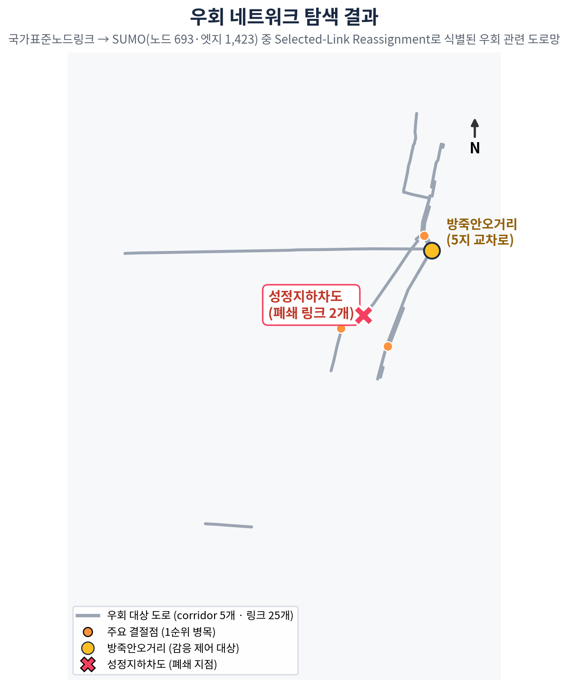

# 성정지하차도 침수 예측 · 선제 신호 전환 시뮬레이션

> 2026 천안시 AI·데이터 기반 정책 아이디어 경진대회 출품작
> 강수량으로 지하차도 침수를 예측하고, **통제 직전에 우회로 교차로 신호를 감응 제어로 전환**해 우회 정체를 줄이는 시스템을 3D 웹 시뮬레이션과 SUMO 미시 교통 시뮬레이션으로 검증했습니다.


## 한눈에 보기

| 항목 | 내용 |
|---|---|
| 문제 | 천안 지하차도 24곳 중 23곳이 침수 위험 등급이며, 성정지하차도는 2017·2020·2025·2026년에 침수가 반복됐습니다. 지하차도를 통제하면 차량이 우회로로 몰려 병목이 생깁니다. |
| 핵심 결과 | 통제 시점에 우회로 교차로(방죽안오거리)를 고정주기에서 **감응 제어로 전환**하면 총 지체가 **227.6 → 15.4 (−93.2%)** 로 줄었습니다 (SUMO). |
| 뒤집힌 가설 | 처음 가설인 "통제 전 차량을 미리 우회시키기"는 SUMO에서 오히려 **+51.8% 악화**됐습니다. 그래서 선제 대응의 대상을 차량 우회에서 **신호 전환**으로 바꿨습니다. |
| 결과물 | CesiumJS 3D 시뮬레이션, 실사 침수 뷰, 우회 네트워크 분석 지도, 검증 보고서 6종 |

## 분석 흐름

```
강수량 → 침수 수위 예측 모델 ─┐
                               ├→ 통제 시점 판단 → 우회로 신호 감응 제어 전환 → SUMO로 효과 검증
국가표준노드링크 → 도로 그래프 ─┘
   └ NetworkX 순환(Loop) 탐색 → Selected-Link Reassignment(우회 분담률) → 병목 교차로 선정
```

1. **도로망 구축**: 국가표준노드링크(MOCT NODE/LINK, 회전제한 정보)를 파싱해 유향 그래프를 만들었습니다.
2. **우회 경로 식별**: 지하차도 링크를 끊었을 때 차량이 어디로 재배정되는지 Selected-Link Reassignment로 계산했습니다. 대흥로 37.9%, 중앙로 35.2%가 우회 교통을 받습니다.
3. **제어 대상 선정**: 우회 교통이 모이는 5지 교차로인 방죽안오거리를 신호 제어 대상으로 정했습니다.
4. **시뮬레이션 검증**: 노드 693·엣지 1,423개의 SUMO 네트워크에서 고정주기와 감응 제어를 같은 교통 수요·같은 랜덤 시드로 비교했습니다.
5. **시각화**: 침수 예측 → 신호 전환 → 우회 흐름을 CesiumJS 3D 지형 위에서 단계별로 보여줍니다.



## 실행 방법

`app/index.html`을 바로 더블클릭하면 브라우저 보안 정책 때문에 열리지 않습니다. 로컬 서버로 여세요.

```bash
cd app
python3 -m http.server 8000
# 브라우저에서 http://localhost:8000/index.html
```

- Mac은 `app/실행_Mac.command`, Windows는 `app/실행_Windows.bat`을 더블클릭해도 됩니다.
- CesiumJS는 CDN에서 불러오므로 인터넷 연결이 필요합니다.
- (선택) 고해상 지형: [Cesium ion](https://ion.cesium.com/tokens)에서 토큰을 발급받아 `app/config.example.js`를 `app/config.js`로 복사하고 토큰을 넣으세요. `config.js`는 `.gitignore`에 있어 저장소에 올라가지 않으며, 토큰이 없어도 기본 고도로 동작합니다.
- `실사침수뷰.html`의 배경 로드뷰 사진은 저작권 문제로 저장소에서 뺐습니다. 직접 찍은 사진을 `app/underpass_photo.png`로 넣으면 동작합니다.

## 저장소 구성

| 경로 | 내용 |
|---|---|
| `app/` | CesiumJS 3D 시뮬레이션(`index.html`), 실사 침수 뷰, 실행 스크립트, 우회로 데이터 |
| `data/` | 우회 경로 JSON(분담률·좌표), SUMO 네트워크 평균속도 그래프 |
| `maps/` | 루프 네트워크·분담률 비례 우회경로·방죽안오거리 확대·실제 루프 구조 지도 |
| `docs/` | 모델 검증 보고서, 선제대응 지체 개선표, 코드 정리 1·2, SUMO 결과, 데이터 출처 (Word) |
| `sumo/` | SUMO 시뮬레이션 설계·재검증 프롬프트 |

## 검증 상태

결과를 과장하지 않기 위해 검증된 것과 아닌 것을 나눠 적었습니다.

- **SUMO 검증됨**: 통제 시점 감응 제어 전환 시 총 지체 −93.2% (227.6 → 15.4).
- **SUMO 검증됨**: 차량 선제 우회는 +51.8% 악화.
- **미검증**: 통제 15분 전부터 우회로 녹색 시간을 분당 1초씩(최대 45초) 늘리는 점진 조정은 3D 데모의 설계값입니다. SUMO 재검증은 `sumo/SUMO_재검증_프롬프트.md`로 준비했습니다.
- **가정값**: 배수 능력 2.8 cm/분은 문헌 기반 가정이며, 실측값은 정보공개청구로 확인할 예정입니다.
- `data/network_speed_timeline.png`는 팀원이 SUMO에서 직접 출력한 원본 그래프입니다(그래프 안 한글 글꼴이 깨져 있음). 빨간 선은 고정주기, 파란 선은 감응 제어이며 20분에 지하차도가 통제됩니다.

## 팀과 역할

팀 프로젝트입니다. SUMO 미시 시뮬레이션은 팀원이 실행했고, 도로망 분석·침수 예측 로직·3D 시뮬레이션·문서화는 [@tfmoty](https://github.com/tfmoty)(김명재)가 맡았습니다.

## 데이터 출처

국토교통부 국가표준노드링크, 천안시 스마트교차로 실측(평일 6일), 언론 보도 기반 침수 이력. 자세한 내용은 `docs/데이터_출처_정리.docx`에 있습니다.
